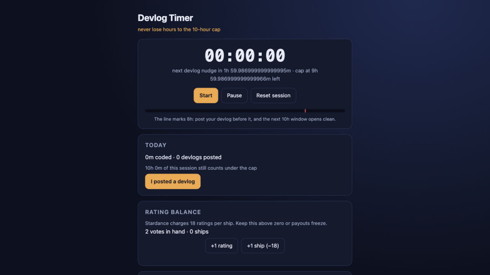

# Devlog Timer

Never lose hours to the 10-hour cap. A single-page timer for Hack Club
Stardance builders that makes the payout rules visible while you code:

1. **Cap meter** — a session clock with the 10-hour devlog cap drawn as a
   progress bar and a red line at 8h ("post before this"). The status line
   counts down both the next 2-hour devlog nudge and the cap.
2. **Today tracker** — daily coded minutes and devlogs posted, with an
   "I posted a devlog" button that banks the safe hours.
3. **Rating balance** — counts the 18-ratings-per-ship debt; shows your live
   vote balance so a payout never freezes on you.
4. **Devlog template** — one-click copy of the what-I-made / what-was-hard /
   proud-of / try-it scaffold.
5. **Tab-close guard** — closing the tab while a running session is past the
   8h line asks for confirmation, so the nudge survives a stray Cmd-W.
6. **Devlog history** — the last 5 "I posted a devlog" taps with timestamps,
   newest first, persisted so your cadence is visible.
7. **Rollover guard** — uncapped overflow above 600 minutes carries into the
   new day instead of vanishing at midnight, and a red "over the cap by
   Xh Ym — post now" line appears whenever the day total is past the cap.
8. **Installable (PWA-lite)** — web app manifest with a dark theme and
   star-on-dark icons, so the timer can run in its own window from the dock.

Vanilla HTML/CSS/JS, zero dependencies, everything in localStorage.

Live: https://aariv.me/devlog-timer/

Manual browser checks worth doing after changes: the beforeunload prompt
(start a session, fast-forward past 8h, close the tab) and the install
prompt (Chrome/Safari → Install "Devlog Timer").

## Why I built this

I lost about a hundred hours of payout to the 10-hour devlog cap in one
backfilled devlog, so I built the watchman I needed: the cap, visible while
you code, with a nudge before it's too late.

## Honest AI note

Built by AI coding agents (ZCode) under Aariv Patel's direction for the
Stardance Frictionless mission; Aariv set the problem (he lost ~100 hours to
the cap in one backfilled devlog) and reviewed the result.

## License

MIT.
